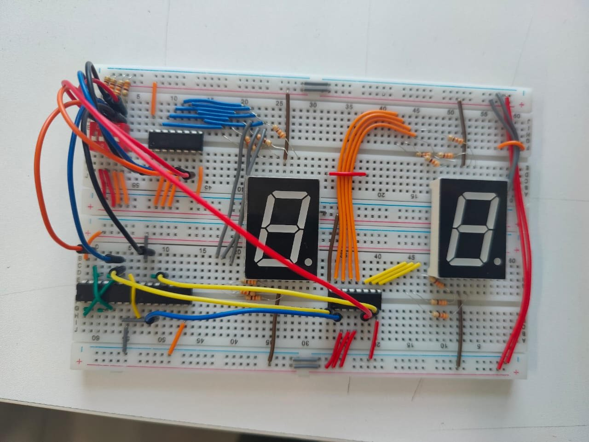
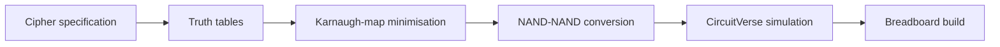
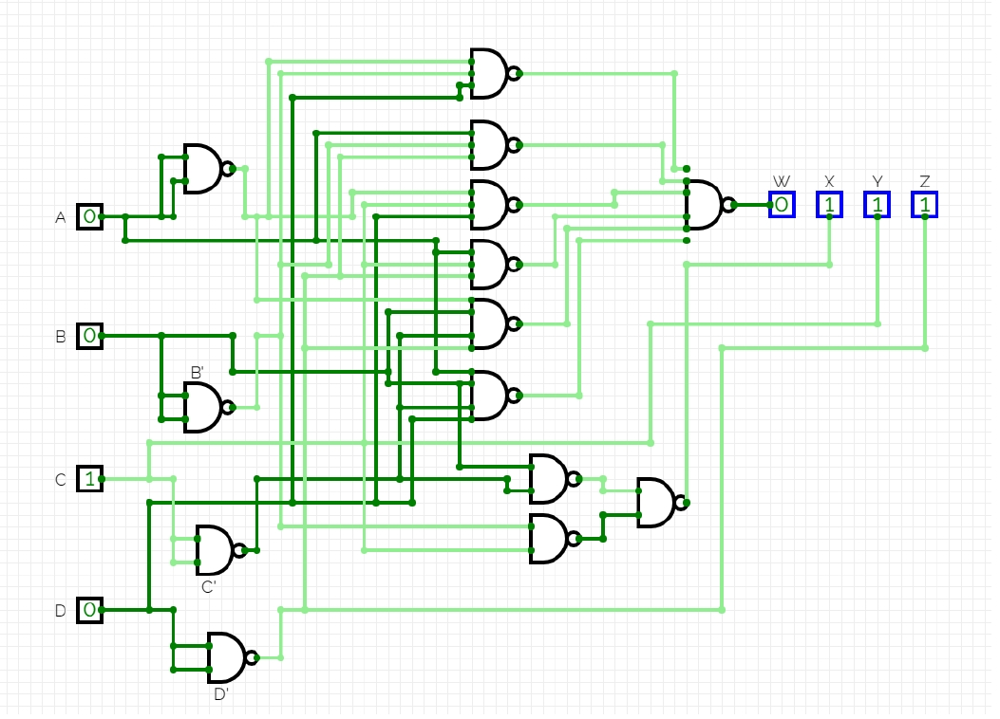
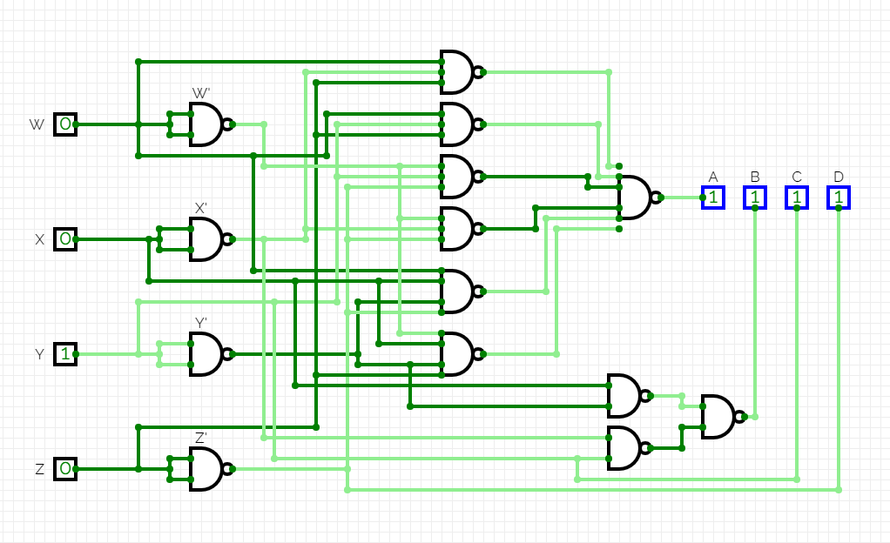

<div align="center">

# 🔐 4-Bit Encryption & Decryption Circuit

**A reversible 4-bit cipher designed from truth tables, minimised with Karnaugh maps, built entirely from NAND gates, simulated in CircuitVerse and wired on a real breadboard.**

[](https://github.com/DanEhab/4bit-encryption-decryption-circuit/actions/workflows/verify.yml)




</div>

---

## Overview

The circuit takes a 4-bit input **ABCD** and turns it into a 4-bit ciphertext **WXYZ**. A second circuit takes **WXYZ** and recovers the original **ABCD** exactly.

The whole project was done by hand at gate level, with no HDL. The steps were:



| | Encryption | Decryption |
|---|---|---|
| Inputs → outputs | `ABCD → WXYZ` | `WXYZ → ABCD` |
| Gate type | NAND only | NAND only |
| Gates used | 14 | 14 |
| Verified for | all 16 inputs | all 16 inputs |

---

## The cipher

<details open>
<summary><b>Encryption truth table</b> (all 16 inputs)</summary>

| A B C D | → | W X Y Z | hex |
|:-------:|:-:|:-------:|:---:|
| 0 0 0 0 | → | 0 0 0 1 | 0 → 1 |
| 0 0 0 1 | → | 1 0 0 0 | 1 → 8 |
| 0 0 1 0 | → | 0 1 1 1 | 2 → 7 |
| 0 0 1 1 | → | 1 1 1 0 | 3 → E |
| 0 1 0 0 | → | 1 1 0 1 | 4 → D |
| 0 1 0 1 | → | 0 1 0 0 | 5 → 4 |
| 0 1 1 0 | → | 0 0 1 1 | 6 → 3 |
| 0 1 1 1 | → | 1 0 1 0 | 7 → A |
| 1 0 0 0 | → | 1 0 0 1 | 8 → 9 |
| 1 0 0 1 | → | 0 0 0 0 | 9 → 0 |
| 1 0 1 0 | → | 1 1 1 1 | A → F |
| 1 0 1 1 | → | 0 1 1 0 | B → 6 |
| 1 1 0 0 | → | 0 1 0 1 | C → 5 |
| 1 1 0 1 | → | 1 1 0 0 | D → C |
| 1 1 1 0 | → | 1 0 1 1 | E → B |
| 1 1 1 1 | → | 0 0 1 0 | F → 2 |

The decryption table is the same mapping read from right to left.

</details>

### Minimised equations (from the K-maps)

**Encryption**

```
W = A'B'D + AB'D' + A'CD + ACD' + A'BC'D' + ABC'D
X = BC' + B'C
Y = C
Z = D'
```

**Decryption**

```
A = WYZ + W'YZ' + W'X'Z' + WXY'Z' + W'XY'Z + WX'Z
B = X'Y + XY'
C = Y
D = Z'
```

Each sum-of-products was then converted to a **NAND-NAND** form, so both circuits use only one gate type, just as they would on a single family of logic ICs.

---

## Circuits

<table>
<tr>
<td align="center"><b>Encryption</b> (ABCD → WXYZ)</td>
<td align="center"><b>Decryption</b> (WXYZ → ABCD)</td>
</tr>
<tr>
<td></td>
<td></td>
</tr>
</table>

## Hardware build

After the simulation, the design was wired on a breadboard with logic ICs, and two **seven-segment displays** show the result (photo at the top).

---

## Verification

`verify.py` rebuilds both truth tables directly from the minimised equations above and checks them against the specification. It has no dependencies.

```console
$ python verify.py
[PASS] Encryption equations match the specification
[PASS] Decryption equations match the specification
[PASS] Encryption is one-to-one (16 distinct outputs)
[PASS] decrypt(encrypt(x)) == x for all 16 inputs
[PASS] XOR form: W = A ^ D ^ (B & ~C)
[PASS] XOR form: A = W ^ ~Z ^ (X & ~Y)
```

Run `python verify.py --markdown` to print the truth table shown above. The same checks run automatically on every push through GitHub Actions.

---

## Looking back

Looking at the equations again later shows a much simpler structure behind the cipher:

```
W = A ⊕ D ⊕ (B · C')        A = W ⊕ Z' ⊕ (X · Y')
X = B ⊕ C                    B = X ⊕ Y
Y = C                        C = Y
Z = D'                       D = Z'
```

Every output bit is a simple step that can be undone, which is why decryption works. With XOR gates, encryption needs only **6 gates** (3 XOR, 1 AND, 2 NOT), compared with 14 NAND gates of up to six inputs. The course required the NAND-only version, but this shows how choosing the right gate type can make a design smaller and clearer.

---

## Repository structure

```
.
├── README.md
├── verify.py                     # rebuilds and checks both truth tables
├── images/
│   ├── hardware-build.jpg        # breadboard build
│   ├── encryption-circuit.png    # CircuitVerse, NAND-only
│   └── decryption-circuit.png    # CircuitVerse, NAND-only
└── .github/workflows/verify.yml  # runs verify.py on every push
```

## Team & course

Built as a team project for **ELCT201 Digital Logic Design**, German University in Cairo, Spring 2023.

**Team:** Daniel Ehab · Abdelrahman Mahmoud · Alqassem Shereif · Zyad Mohamed

**Instructors:** Prof. Tallal Elshabrawy, Dr. Minar El Aasser, Dr. Wassim Alexan
